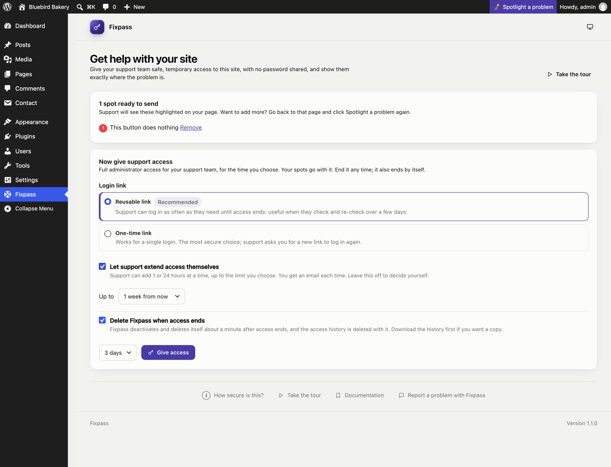
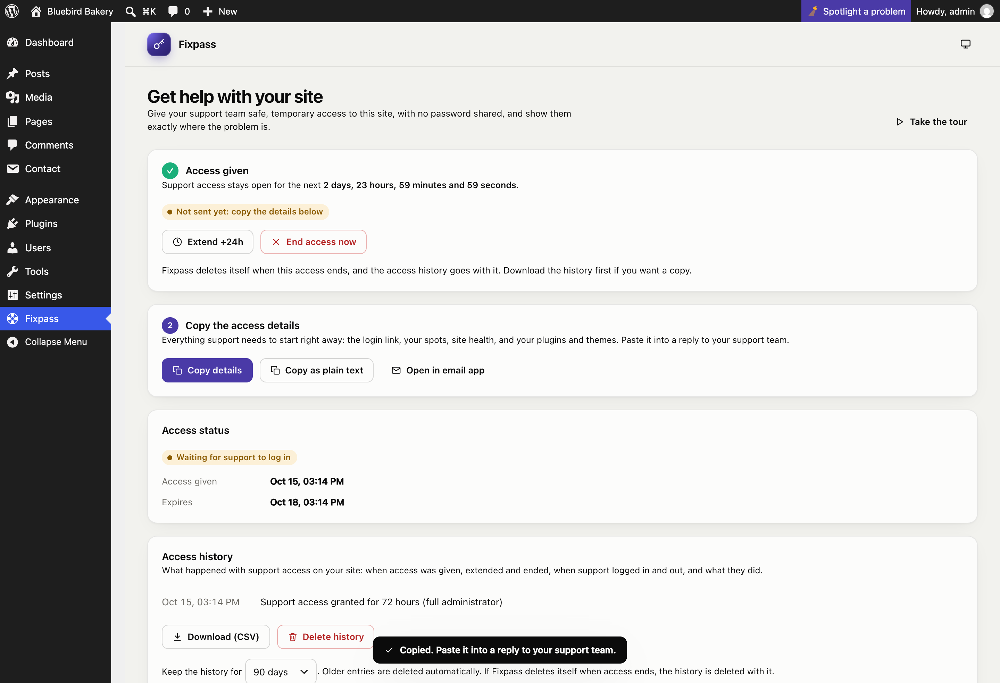
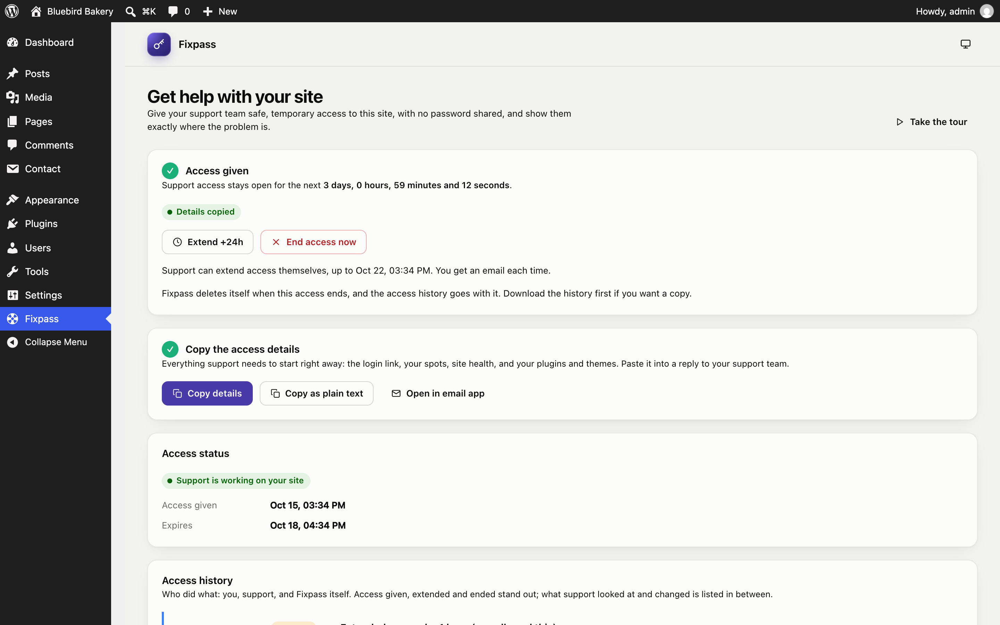
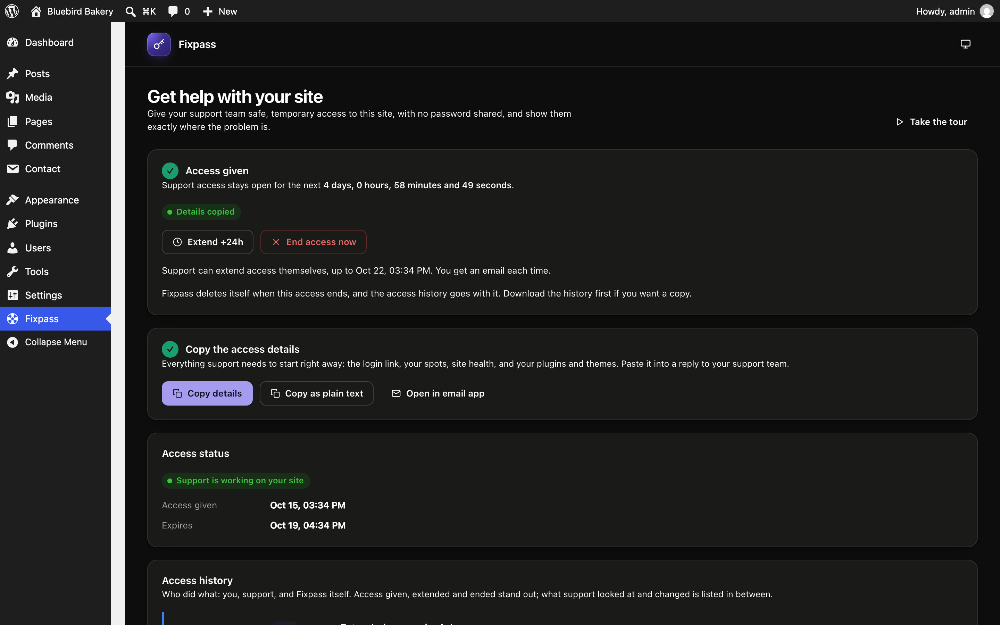
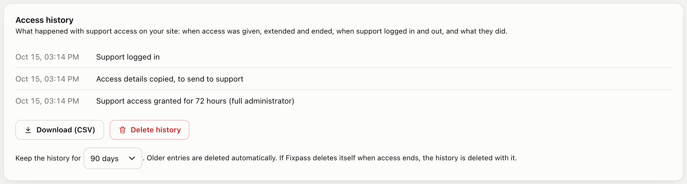
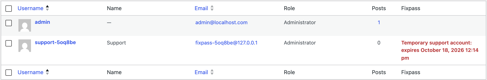

# Giving support access

Support access is a temporary **full administrator** account for your support team. There's no password: they log in with a link you send them.

## Start: two choices

The **Fixpass** page opens with two big buttons:

- **Show the problem, then give access** (recommended): you point at what's wrong on your site with [Spotlight](spotlight.md), then give access. Support sees exactly what you mean. It takes about 2 minutes.
- **Just give access:** the quickest, about 30 seconds. Good when the whole site is down, or you can't open the page. You describe the problem in your message.

Picking the first shows three short steps (go to the page, click **Spotlight a problem**, click **Continue**). When you come back, your spots are listed with a **Remove** link for any you don't want to send, and the access form is right below.

## Give access

Choose the options, then a length (**1, 2, 3 (the default) or 5 days, or a week**), and click **Give access**:

- **Login link:**
  - **Reusable link** (recommended): support can log in as often as they need until access ends. Best when they check, change and re-check over a few days.
  - **One-time link:** works for a single login. The most secure choice; if support needs to log in again, they ask you for a new link.
- **Let support extend access themselves** (off by default): support can add **1 or 24 hours** at a time from their Support session page, up to a limit you set: **1 week**, **2 weeks** or **30 days from now**, or **a specific date** (never more than 30 days from when access was given). You get an email each time, and each extension is in the access history. Leave it off if you'd rather decide yourself.
- **Delete Fixpass when access ends** (ticked by default): once access has ended, for whatever reason, Fixpass deactivates and deletes itself about a minute later. **The access history is deleted with it**, so download the history first if you want a copy. Untick it to keep Fixpass installed.

One support access can be open at a time.

## Copy the details

- **Copy details** copies a formatted message (for email): a **Log in to the site** button, the link, when access ends, your spots with links that open each page highlighted, site health, recent fatal errors from the debug log, and your active and inactive plugins and themes.
- **Copy as plain text** copies the same as plain text, for tickets and chats.
- **Open in email app** starts an email with the details. Email apps cut long messages short, so for long details paste from **Copy details** instead.

Paste the details into a reply to your support team. This always reaches them, because it doesn't depend on your site sending email.

If your browser blocks copying, the text appears in a box so you can copy it yourself.

**Copying again later:** a reusable link comes back the same. A one-time link is replaced each time you copy after reloading the page, and the earlier link stops working.

## The status

While access is open, the page shows:

| Status | Meaning |
|---|---|
| Waiting for support to log in | The link hasn't been used yet. |
| Support is working on your site | Support is logged in. |
| Support logged out | Support logged out; access is still open. |
| Support ended the session | Support clicked **Leave session**; access is still open. |

The page refreshes the status by itself every few seconds (and as soon as you come back to the tab), and counts down to when access ends. You don't need to reload it.

After access ends, **Last support access** shows how it ended:

| Status | Meaning |
|---|---|
| You ended access | You clicked **End access now**. |
| Support revoked access | Support clicked **End access** when they were done. |
| Access expired | The time ran out. |
| Access ended: the support account was deleted | Someone deleted the support account (for example on the Users screen). |
| Access ended: Fixpass was deactivated | Fixpass was deactivated while access was open. |

## Access history

Below the status, **Access history** lists what happened, with **who did it**:

- **You** (purple): you gave access, extended it, ended it, copied the details.
- **Support** (amber): they logged in or out, extended access (if you allowed it), ended it when they were done, started troubleshooting mode, and what they changed on the site. Tick **Include every page support looked at** to see those too.
- **Fixpass** (grey): access ran out as planned, or ended because the support account was deleted or Fixpass was deactivated.

Access events stand out, with a coloured edge: green for access given and logins, blue for extensions, red for access ending. The things support did on the site are listed in smaller text between them.

- **Download (CSV):** saves the whole history as a spreadsheet file, with columns for the time, who did it, what happened and the IP address of logins.
- **Delete history:** removes the record of past access and what support did, and the access that has ended. It can't be undone. Access that is open right now keeps its own history.
- **Keep the history for:** 30, 90 (the default) or 365 days. Older entries are deleted automatically.

If **Delete Fixpass when access ends** is ticked, the history is deleted along with Fixpass.

## Extend or end access

- **Extend +24h** adds a day. One access can last at most 30 days from when it was given.
- If you allowed it, support can extend by 1 or 24 hours themselves (see above).
- **End access now** ends it straight away: the support account is deleted and the link stops working.

However access ends, the support account is deleted for good.

## The Users screen

The support account shows in **Users** with a **Fixpass** column: "Temporary support account: expires …" while access is open. Other administrators can see what it is. Deleting it there ends the access.

